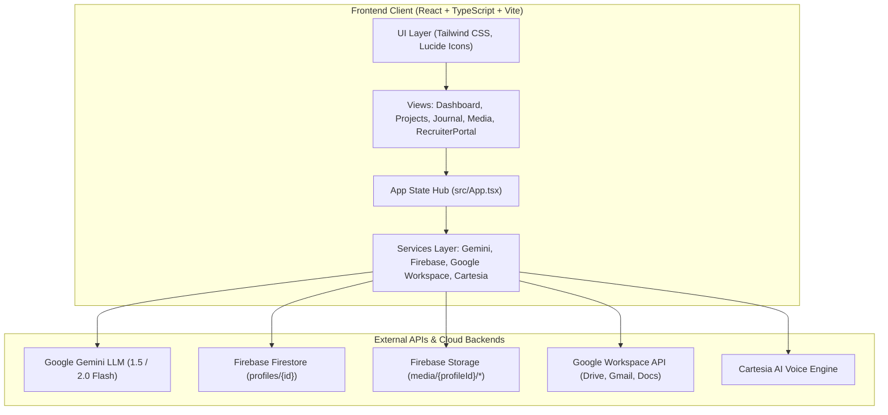
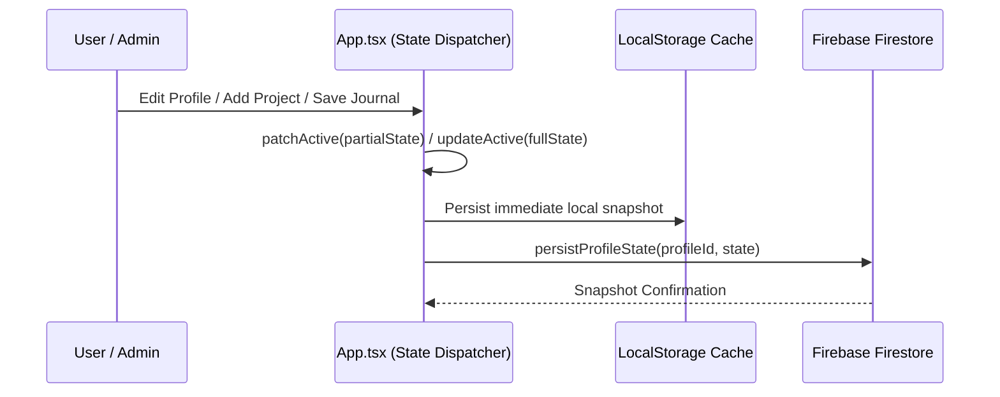
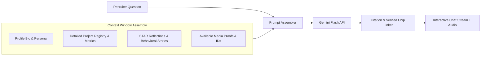
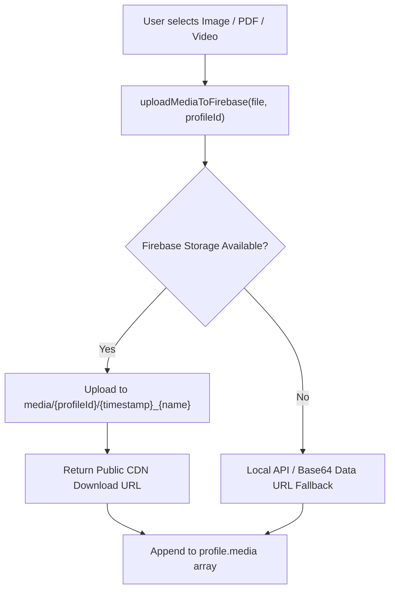

# Kaitana — Architecture Blueprint (`architecture.md`)

This document outlines the system architecture, component breakdown, data flow, state management, and external service integrations of the Kaitana platform.

---

## 1. High-Level Architecture Overview

---

## 2. Core State Management & Profile Engine

Kaitana manages state through a centralized profile state engine in [`src/App.tsx`](file:///src/App.tsx):

### Data Schema (`ProfileState`)
Each profile (Vance, Chen, or Custom) conforms to the unified `ProfileState` interface defined in [`src/types.ts`](file:///src/types.ts):

- **`user`**: `name`, `role`, `bio`, `avatar`, `voiceId`, `targetRole`, `location`.
- **`projects`**: Array of project objects containing `id`, `title`, `description`, `role`, `period`, `impact`, `techStack`, `metrics`, and linked `mediaIds`.
- **`journal`**: Array of structured reflection entries (`id`, `prompt`, `category`, `answer`, `timestamp`, `tags`).
- **`media`**: Array of uploaded or linked assets (`id`, `url`, `type`, `title`, `description`, `projectId`).
- **`recruiterNotes` / `logs`**: History of recruiter interactions, shadow interview transcripts, and audit scores.

### Synchronization Pipeline: Offline-First + Real-Time Firestore
The state lifecycle follows a robust offline-first pattern:

- When the application mounts, `subscribeToProfile` registers a real-time Firestore listener.
- If Firestore is offline, rules restrict access, or network latency occurs, Kaitana seamlessly reads and writes from `localStorage` (`kaitana_profile_<id>`).

---

## 3. AI Grounding & Prompt Synthesis

The shadow interview engine ensures the AI cannot hallucinate credentials:

### Prompt Guardrails
1. **Persona Alignment**: Injects the candidate's exact tone, experience level, and preferred terminology.
2. **Strict Verification**: Queries requiring unrecorded experience trigger a polite, realistic disclaimer (e.g., *"While I have extensive experience in distributed queuing with Kafka, I have not personally managed Apache Pulsar in production"*).
3. **Structured Citation Format**: The model formats references using bracket notation (`[Project: Project Name]` or `[Evidence: Media ID]`), which the frontend regex-parses into clickable interactive cards.

---

## 4. Media Pipeline & Storage

Media uploads are handled by [`src/services/firebase.ts`](file:///src/services/firebase.ts) and [`src/components/MediaManager.tsx`](file:///src/components/MediaManager.tsx):

---

## 5. Directory & Module Map

| Path | Purpose |
| :--- | :--- |
| `src/App.tsx` | Root component, navigation router, active profile state hub |
| `src/types.ts` | Complete TypeScript type definitions for profiles, projects, media, and recruiter logs |
| `src/data/demoProfiles.ts` | Static baseline data for default profiles (`vance`, `chen`, `custom`) |
| `src/services/firebase.ts` | Firebase App, Auth, Firestore real-time sync, and Storage service |
| `src/services/googleWorkspace.ts`| Google Drive Picker, Gmail Compose API, Google Docs Export integration |
| `src/services/ttsService.ts` | Cartesia AI low-latency voice synthesis and Web Speech API fallback |
| `src/services/linkedinService.ts`| LinkedIn profile parser and career history importer |
| `src/components/Dashboard.tsx` | Overview of profile stats, grounding score, and quick actions |
| `src/components/Projects.tsx` | Project creation, editing, and metric tracking |
| `src/components/Journal.tsx` | Behavioral prompt reflection editor and STAR interview prep |
| `src/components/MediaManager.tsx` | Asset gallery, file uploader, and lightbox inspection |
| `src/components/RecruiterPortal.tsx`| The public AI shadow interview interface with TTS audio and citation chips |
| `src/components/Sidebar.tsx` | Profile switcher, navigation tabs, and identity editor |
| `src/components/PortfolioAudit.tsx`| AI audit for portfolio completeness and metric coverage |
